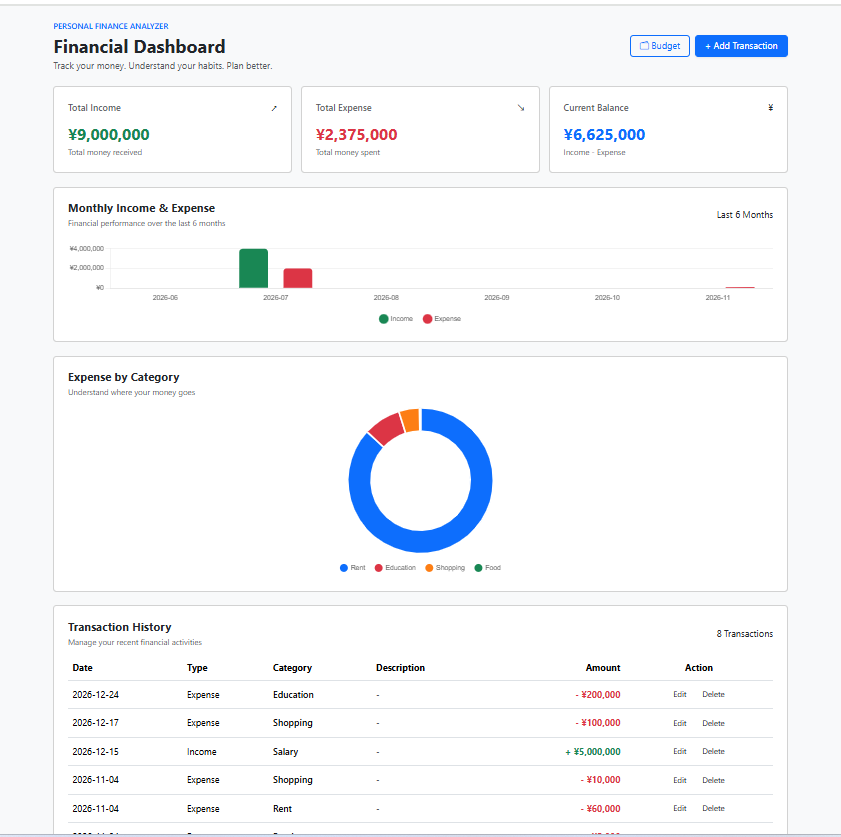
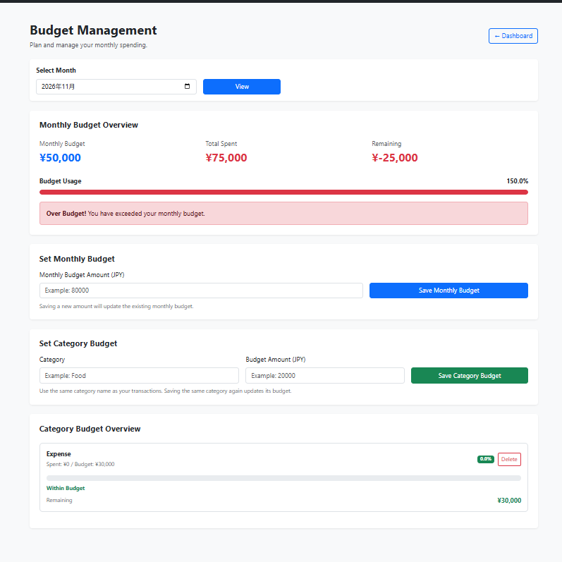

# Personal Finance Analyzer

A web-based personal finance management application built with Python and Flask.

## Overview

Personal Finance Analyzer is a web application that helps users manage their daily income and expenses, track monthly budgets, and understand their financial situation through visual charts.

## Features

- Add, edit, and delete income and expense transactions
- View total income, expenses, and balance
- Visualize monthly income and expenses using bar charts
- Analyze expenses by category using doughnut charts
- Create and manage monthly budgets
- Track budget spending and remaining amounts

## Technologies Used

- Python
- Flask
- SQLite
- HTML
- CSS
- JavaScript
- Bootstrap
- Chart.js

## Project Structure

```text
personal-finance-analyzer/
├── app.py
├── requirements.txt
├── templates/
│   ├── base.html
│   ├── index.html
│   ├── budget.html
│   ├── add_transaction.html
│   └── edit_transaction.html
└── static/
    ├── css/
    │   └── style.css
    └── js/
        └── dashboard.js
```
## Installation and Setup

### 1. Clone the repository

```bash
git clone https://github.com/ayechanmaw990-collab/personal-finance-analyzer.git
cd personal-finance-analyzer
```

### 2. Create a virtual environment

```bash
python -m venv .venv
```

### 3. Activate the virtual environment

Windows:

```powershell
.venv\Scripts\activate
```

### 4. Install dependencies

```bash
pip install -r requirements.txt
```

### 5. Run the application

```bash
python app.py
```

Open your browser and visit:

```text
http://127.0.0.1:5000
```
## What I Learned

- Developing web applications using Python and Flask
- Designing and managing databases with SQLite
- Implementing CRUD operations
- Creating interactive charts with Chart.js
- Separating HTML, CSS, and JavaScript for maintainable code
- Managing source code with Git and GitHub

## Future Improvements

- Add user authentication
- Improve dashboard design and usability
- Add data export functionality
- Enhance financial analysis features

## Author

Developed as a personal portfolio project.
## Screenshots

### Dashboard


### Budget Management


## 日本語

### プロジェクト概要

Personal Finance Analyzer は、Python と Flask を使用して開発した個人向けの家計管理Webアプリケーションです。

収入・支出の登録や編集、削除、月別の収支確認、予算管理などの機能を実装しました。また、Chart.js を使用して、月別の収支やカテゴリー別の支出をグラフで可視化しています。

### 主な機能

- 収入・支出の登録、編集、削除
- 収入・支出・残高の表示
- 月別の収支グラフ
- カテゴリー別の支出グラフ
- 月別・カテゴリー別の予算管理
- 予算の使用額と残額の確認

### 使用技術

- Python
- Flask
- SQLite
- HTML / CSS / JavaScript
- Bootstrap
- Chart.js

### 開発を通して学んだこと

Flaskを使ったWebアプリケーションの開発、SQLiteによるデータベース管理、CRUD機能の実装、Chart.jsによるデータの可視化について学びました。

また、HTML・CSS・JavaScriptを分離し、保守しやすい構成を意識して開発しました。
